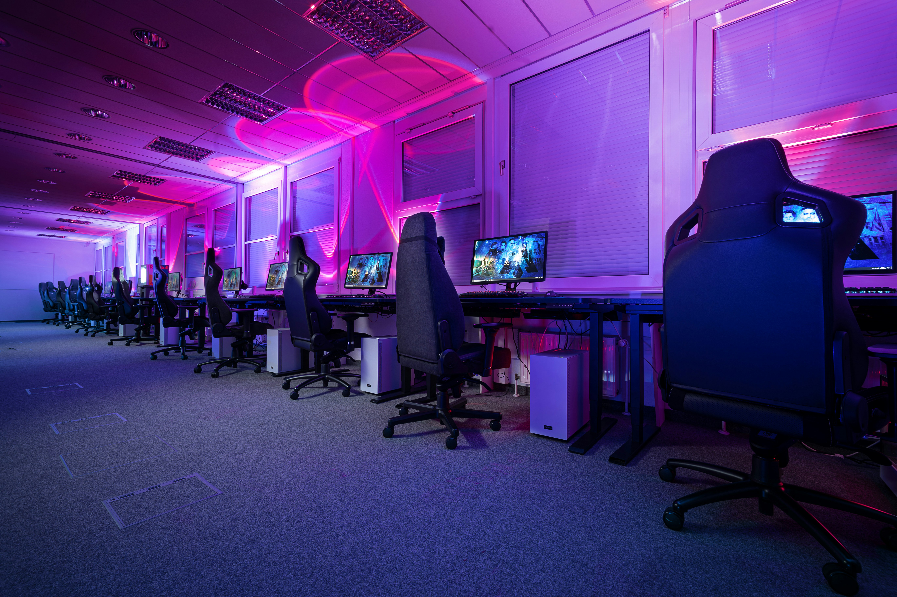
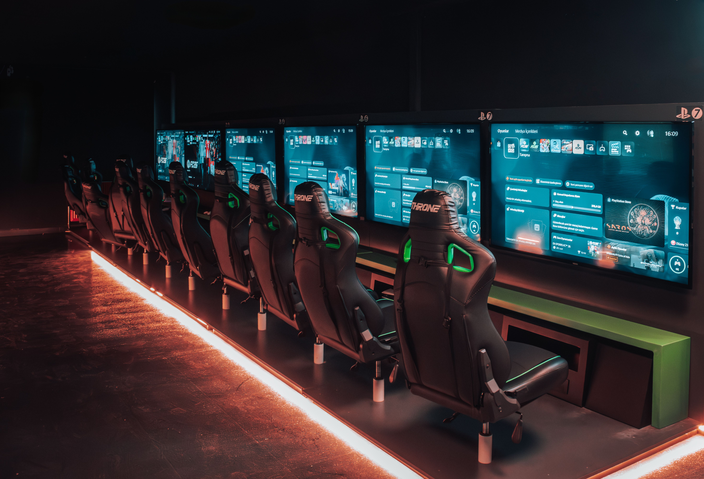

# wede5020-g1-2026-formative-1-part-1-olwethu-zulu
# King'z Arena - Web Development PoE Part 1

**Developer:** [Olwethu Zulu]
**Student Number:** [ST10506038]

## Project Overview
King'z Arena is a website for a high-end esports and gaming lounge. It promotes the arena's equipment, tournaments and booking options, and lets visitors enquire about booking a slot.

## Goals
* Present the arena's features clearly to gamers and tournament players.
* Make it easy to enquire or book a slot from any page.
* Work well on desktop, tablet and mobile devices.

## Features (Part 1)
* Semantic HTML5 markup across 5 interconnected pages.
* Clean directory structure with isolated `_css` and `_images` folders.
* Low-fidelity wireframes and structural sitemaps included in the proposal document.

## Current Features 
- **Semantic HTML5 Markup:** Structured across 5 interconnected pages (`index.html`, `about.html`, `products.html`, `enquire.html`, `contact.html`).
- **Master CSS (`_css/style.css`):** Custom Next Level Gaming dark-themed styling, CSS Grid layouts, Flexbox wrappers, responsive media containers (`.fluid-media`), and mobile-first media queries.
- **Master JavaScript (`_js/main.js` & jQuery):** Lightweight product search/filter logic, interactive enquiry cost calculations, contact form validation with error messaging, image lightbox modals, and Leaflet bounds-fitting map integrations.
- **Organized Asset Architecture:** Isolated directories for stylesheets (`_css`), scripts (`_js`), images (`_images`), and videos (`_videos`).

## Directory
📦kingz_arena
 ┣ 📂_css
 ┃ ┗ 📜style.css
 ┣ 📂_images
 ┃ ┣ 📜andile.jpg
 ┃ ┣ 📜arena_floor.jpg
 ┃ ┣ 📜controller.jpg
 ┃ ┣ 📜esports.jpg
 ┃ ┣ 📜founder.jpg
 ┃ ┣ 📜karen.jpg
 ┃ ┣ 📜racing.jpg
 ┃ ┣ 📜room.jpg
 ┃ ┣ 📜setup.jpg
 ┃ ┣ 📜vip.jpg
 ┃ ┗ 📜vr.jpg
 ┣ 📂_js
 ┣ 📂_videos
 ┃ ┗ 📜gaming.mp4
 ┣ 📜about.html
 ┣ 📜contact.html
 ┣ 📜enquire.html
 ┣ 📜index.html
 ┗ 📜products.html

## 📅 5. Weekly Development Timeline

* **Week 1:** Project proposal, low-fidelity wireframes, and structural sitemaps in Figma.
* **Week 2:** Development of foundational HTML5 markup across all 5 interlinked pages and directory structuring (`_css`, `_images`).
* **Week 3 (Current):** Implementation of master CSS stylesheet, relative units (`rem`, `%`), media queries, grid tile components, and dark-themed embedded Google Maps.
* **Week 4:** JavaScript integration, interactive form validation, and final cross-browser accessibility audit.

---

## 💰 6. Estimated Budget Breakdown

| Item | Service Provider / Details | Cost (ZAR) |
| :--- | :--- | :--- |
| **Domain Registration (.co.za)** | Xneelo Hosting (Annual) | R100.00 |
| **Web Hosting (Pro Plan)** | Hostinger South Africa (Monthly) | R150.00 |
| **Development Hours** | 40 hours @ R300.00/hr | R12,000.00 |
| **Total Initial Cost** | | **R12,250.00** |

---

## 🖼️ 7. Media & Asset Gallery

| Main Arena Floor | Gaming Controller | VIP Lounge Setup |
| :---: | :---: | :---: |
|  |  |  |
| *Main Tournament Arena* | *Pro Gear & Peripherals* | *VIP Lounge Station* |

| Pro Setup Rig | Founder: King | Tech Lead: Andile |
| :---: | :---: | :---: |
|  |  |  |
| *High-FPS Gaming Rig* | *Founder & CEO* | *Head Technician* |

---

## 🛠️ 8. Tools & Technologies
* **Code Editor:** Visual Studio Code
* **Design & Wireframing:** Figma & FigJam
* **Architecture Planning:** Microsoft Word (Sitemaps & Documentation)
* **Version Control:** GitHub
* **Stock Photography:** Unsplash & Pexels (Royalty-Free Licensing)

---

## 📚 9. References

* **Duckett, J.** (2011) *HTML and CSS: Design and Build Websites*. Indianapolis: John Wiley & Sons, Inc.
* **Figma Inc.** (2026) *Figma: Collaborative Interface Design Tool*. Available at: https://www.figma.com [Accessed 5 October 2026].
* **Google Maps.** (2026) *Google Maps Embed API Documentation*. Available at: https://developers.google.com/maps/documentation/embed [Accessed 5 October 2026].
* **Hostinger South Africa.** (2026) *Web Hosting Pricing & Hosting Plans*. Available at: https://www.hostinger.co.za/web-hosting [Accessed 5 October 2026].
* **MDN Web Docs.** (2026) *CSS Grid Layout: Comprehensive Developer Guide*. Mozilla Foundation. Available at: https://developer.mozilla.org/en-US/docs/Web/CSS/CSS_grid_layout [Accessed 5 October 2026].
* **MDN Web Docs.** (2026) *The HTML `<picture>` element*. Mozilla Foundation. Available at: https://developer.mozilla.org/en-US/docs/Web/HTML/Element/picture [Accessed 5 October 2026].
* **Pexels.** (2026) *Pexels License & Royalty Free Stock Photography*. Available at: https://www.pexels.com/license [Accessed 5 October 2026].
* **The Independent Institute of Education (IIE).** (2026) *Module Guide and Assignment Brief: Web Development (WEDE5020)*. Johannesburg: The Independent Institute of Education.
* **Unsplash.** (2026) *Unsplash Commercial Photo License*. Available at: https://unsplash.com/license [Accessed 5 October 2026].
* **W3C.** (2023) *CSS Flexible Box Layout Module Level 1*. W3C Recommendation. Available at: https://www.w3.org/TR/css-flexbox-1/ [Accessed 5 October 2026].
* **Xneelo Hosting.** (2026) *Domain Name Registration Pricing*. Available at: https://xneelo.co.za/domain-names/ [Accessed 5 October 2026].
